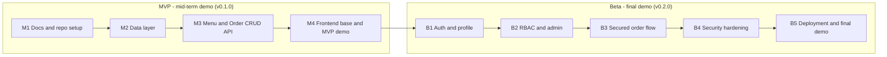

# Product Requirements Document (PRD) - CampusEats

| | |
|---|---|
| **Project** | CampusEats - Campus Cafeteria Pre-Order System |
| **Document** | PRD (Product Requirements Document) |
| **Related docs** | [SRS](02-srs.md), [TDD](03-tdd.md) |
| **Releases** | MVP (mid-term demo) and Beta (final demo) |

Every goal, feature and story in this document is tagged **MVP** or **Beta** so it is clear what will be shown at each demo.

---

## 1. Overview

CampusEats is a web application that lets university students and staff pre-order food from the campus cafeteria, and lets the cafeteria team receive, prepare and track those orders. The goal is to cut queue time and make order handling organised and traceable.

The project is built in two releases:

- **MVP (demo before mid-term):** the core features through REST APIs (menu CRUD, order placement, order status), a basic React UI, running locally with SQLite.
- **Beta (demo before final):** authentication (JWT + refresh token), user roles (RBAC), user profile dashboard, security scopes and permissions, security hardening and deployment to Vercel with Supabase PostgreSQL.

## 2. Problem Statement and Goals

**Problem.** During lunch hours, students wait in long cafeteria queues, orders are taken on paper or verbally, and the kitchen has no clear view of what to prepare next. Students lose class time and the kitchen loses track of orders.

| ID | Goal | Release |
|----|------|---------|
| G-01 | Let customers browse the menu and place an order without queueing | MVP |
| G-02 | Let kitchen staff see incoming orders and update their status | MVP |
| G-03 | Let the cafeteria manage menu items (add, edit, remove) | MVP |
| G-04 | Identify users so each customer sees only their own orders | Beta |
| G-05 | Control who can do what using roles (customer, kitchen staff, admin) | Beta |
| G-06 | Protect the system with secure authentication and hardened APIs | Beta |
| G-07 | Make the system available online for real use | Beta |

## 3. Release Plan (Roadmap)

## 4. Target Users

| User | Description | Release |
|------|-------------|---------|
| Customer | Student or staff member who orders food | MVP (anonymous), Beta (logged in) |
| Kitchen Staff | Cafeteria worker who prepares orders and updates their status | MVP (anonymous), Beta (role) |
| Admin | Cafeteria manager who manages the menu and users | MVP (anonymous), Beta (role) |

In the MVP there is no login, so any client can call any endpoint. Roles are enforced from the Beta release.

## 5. Scope

### 5.1 In scope

| Area | MVP | Beta |
|------|-----|------|
| Menu | CRUD for menu items, search and filter | Admin-only write access |
| Orders | Place order, list, view, update status, cancel | Orders linked to users, customers see only their own |
| Users | None | Register, login, logout, profile, change name and password |
| Roles | None | `customer`, `kitchen_staff`, `admin` with RBAC |
| Admin | None | User management, dashboard statistics |
| Security | Input validation | JWT + refresh token, password hashing, login lockout, CORS, security headers |
| Deployment | Runs locally (SQLite) | Vercel + Supabase PostgreSQL |

### 5.2 Out of scope (this semester)

- Online payment gateway
- Push, SMS or email notifications
- Loyalty points and discounts
- Delivery tracking
- Automated tests and CI/CD

## 6. Feature List (MoSCoW)

| ID | Feature | Priority | Release |
|----|---------|----------|---------|
| F-01 | Menu item CRUD API | Must | MVP |
| F-02 | Menu search and filter (category, availability, keyword) | Should | MVP |
| F-03 | Place an order with multiple items | Must | MVP |
| F-04 | View orders and order details | Must | MVP |
| F-05 | Update order status (pending, preparing, ready, completed) | Must | MVP |
| F-06 | Cancel a pending order | Should | MVP |
| F-07 | React UI: menu page, order form, kitchen board | Must | MVP |
| F-08 | Register and login (JWT + refresh token) | Must | Beta |
| F-09 | User profile dashboard (view and edit profile, my orders) | Must | Beta |
| F-10 | Role-Based Access Control (customer, kitchen staff, admin) | Must | Beta |
| F-11 | Admin user management (list users, change role, deactivate) | Should | Beta |
| F-12 | Admin dashboard statistics | Could | Beta |
| F-13 | Security hardening (hashing, lockout, headers) | Must | Beta |
| F-14 | Deployment to Vercel with Supabase PostgreSQL | Must | Beta |
| F-15 | Payment, notifications, loyalty points | Won't | - |

## 7. User Stories

| ID | Story | Release |
|----|-------|---------|
| US-01 | As an admin, I want to add a menu item so customers can order it. | MVP |
| US-02 | As a customer, I want to browse and search the menu so I can decide what to eat. | MVP |
| US-03 | As an admin, I want to edit or remove menu items so the menu stays correct. | MVP |
| US-04 | As a customer, I want to place an order with several items so I can skip the queue. | MVP |
| US-05 | As kitchen staff, I want to see all incoming orders so I know what to prepare. | MVP |
| US-06 | As kitchen staff, I want to update an order's status so customers know when it is ready. | MVP |
| US-07 | As a customer, I want to cancel an order that has not started so I can change my mind. | MVP |
| US-08 | As a visitor, I want to register an account so I can place orders under my name. | Beta |
| US-09 | As a user, I want to log in and stay logged in securely so I do not retype my password. | Beta |
| US-10 | As a user, I want to view my profile and change my name and password. | Beta |
| US-11 | As a customer, I want to see only my own orders and their status. | Beta |
| US-12 | As the system owner, I want each role limited to its own actions so data is protected. | Beta |
| US-13 | As an admin, I want to manage users (change role, deactivate) so I can control access. | Beta |
| US-14 | As an admin, I want a dashboard of order and user statistics to understand demand. | Beta |
| US-15 | As the system owner, I want repeated failed logins to be blocked to stop password guessing. | Beta |
| US-16 | As a student, I want to use the system online from my phone. | Beta |

## 8. Success Metrics

| Release | Metric | Target |
|---------|--------|--------|
| MVP | All MVP endpoints work and are documented at `/api/docs` | 100% of MVP FRs demonstrated |
| MVP | A customer can place an order from the UI | Under 2 minutes |
| MVP | Kitchen staff can update an order's status | In 3 clicks or fewer |
| Beta | Protected endpoints reject missing or wrong-role access | 100% return 401 or 403 |
| Beta | Passwords stored hashed, no secrets in Git | 0 plain-text secrets |
| Beta | Deployed app reachable online | Available during final demo |
| Beta | API response time on deployed app | Under 500 ms for normal requests |

## 9. Milestones

### MVP (tagged `v0.1.0`)

| Milestone | Deliverable | Output |
|-----------|-------------|--------|
| M1 | Repository, PRD, SRS, TDD, README | Docs merged to `main` |
| M2 | Data layer: SQLModel models, SQLite, schemas | Tables created locally |
| M3 | Menu and Order CRUD REST API with validation | Working API at `/api/v1` |
| M4 | React base UI and mid-term demo | MVP demo running locally |

### Beta (tagged `v0.2.0`)

| Milestone | Deliverable | Output |
|-----------|-------------|--------|
| B1 | Register, login, refresh, profile | Auth endpoints and profile page |
| B2 | RBAC and admin user management | Role dependencies, admin pages |
| B3 | Orders linked to users, secured kitchen board | Per-role order access |
| B4 | Security hardening | Lockout, headers, CORS, validation review |
| B5 | Deployment and final demo | Live Vercel + Supabase app |

## 10. Assumptions and Risks

| Risk | Impact | Mitigation |
|------|--------|------------|
| Scope grows too large | Unfinished project | Keep MVP small, move extras to Beta or Won't |
| Auth bugs expose data | Security failure | Central RBAC dependencies, review the permission matrix |
| Deployment issues late | Final demo fails | Configure Vercel and Supabase early in Beta |
| Team members blocked | Delays | Small issues, short branches, frequent PRs |
