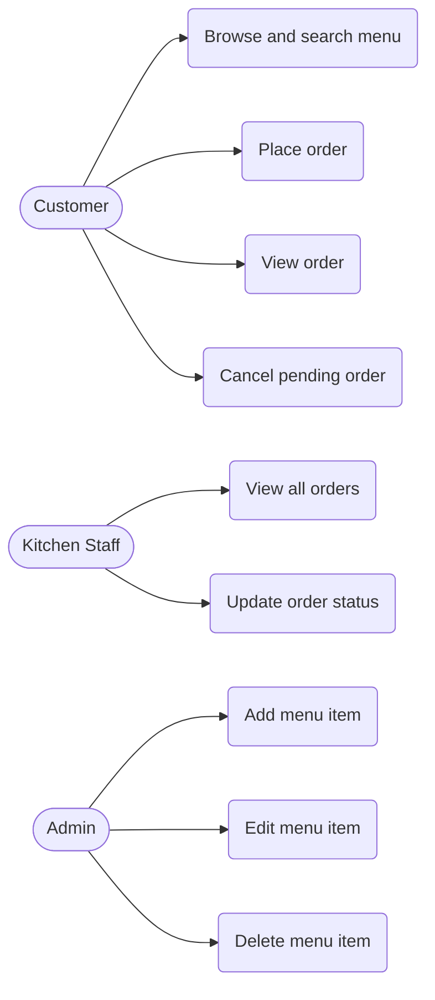
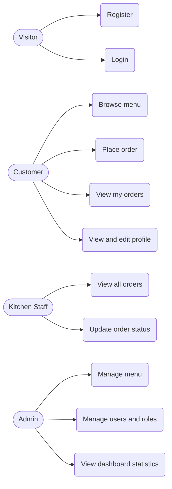
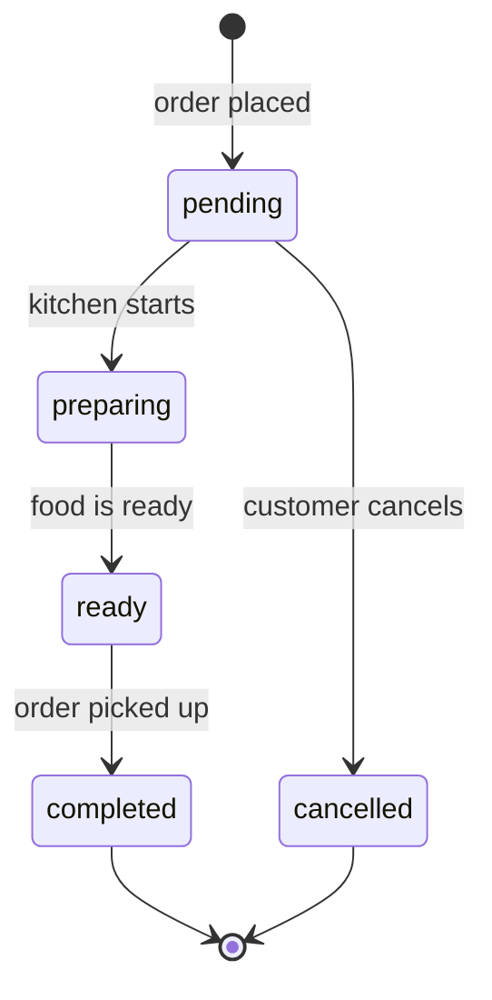

# Software Requirements Specification (SRS) - CampusEats

| | |
|---|---|
| **Project** | CampusEats - Campus Cafeteria Pre-Order System |
| **Document** | SRS (Software Requirements Specification) |
| **Related docs** | [PRD](01-prd.md), [TDD](03-tdd.md) |

Every requirement is tagged **MVP** (mid-term demo) or **Beta** (final demo) and linked to a user story from the [PRD](01-prd.md).

---

## 1. Purpose

This document specifies the functional and non-functional requirements of CampusEats. It is the contract between what the product should do (PRD) and how it is built (TDD), and it is the basis for the acceptance criteria used in the demos.

## 2. Scope

CampusEats lets customers pre-order cafeteria food and lets kitchen staff and admins manage menu items and orders.

| In scope - MVP | In scope - Beta |
|----------------|-----------------|
| Menu item CRUD, search and filter | Register, login, refresh token, logout |
| Place, list, view, cancel orders | User profile (view, change name, change password) |
| Update order status | Roles: `customer`, `kitchen_staff`, `admin` (RBAC) |
| React UI: menu, order form, kitchen board | Admin user management and dashboard statistics |
| REST API with validation, docs at `/api/docs` | Login lockout, security hardening, deployment |

**Out of scope this semester:** online payments, notifications, loyalty points, delivery tracking, automated tests, CI/CD.

## 3. Definitions

| Term | Meaning |
|------|---------|
| CRUD | Create, Read, Update, Delete |
| REST | Architectural style for HTTP APIs using resources and standard methods |
| JWT | JSON Web Token used to prove identity |
| Access token | Short-lived JWT sent with each protected request |
| Refresh token | Longer-lived token used to get a new access token |
| RBAC | Role-Based Access Control: permissions depend on the user's role |
| MVP | First release, core features, runs locally |
| Beta | Second release, auth, roles, security and deployment |
| Order status | `pending`, `preparing`, `ready`, `completed`, `cancelled` |

## 4. User Roles

| Role | Scope | Description | Release |
|------|-------|-------------|---------|
| Anonymous client | Global | Any caller; in the MVP everyone is anonymous | MVP |
| `customer` | Global | Browses the menu, places and views own orders | Beta |
| `kitchen_staff` | Global | Views all orders and updates their status | Beta |
| `admin` | Global | Manages menu, users and views statistics | Beta |

## 5. Use Cases

### 5.1 MVP use case diagram

### 5.2 Beta use case diagram

### 5.3 Use case descriptions

| ID | Use case | Actor | Main flow | Release |
|----|----------|-------|-----------|---------|
| UC-01 | Browse and search menu | Customer | Open menu, optionally filter by category or keyword, see available items | MVP |
| UC-02 | Place order | Customer | Choose items and quantities, submit, receive order with total and status `pending` | MVP |
| UC-03 | Cancel order | Customer | Open a `pending` order, cancel it, status becomes `cancelled` | MVP |
| UC-04 | Update order status | Kitchen Staff | Open an order, move it to the next valid status | MVP |
| UC-05 | Manage menu items | Admin | Add, edit or delete a menu item | MVP |
| UC-06 | Register and login | Visitor | Submit details, receive tokens, access protected pages | Beta |
| UC-07 | Manage profile | Customer | View profile, change name or password | Beta |
| UC-08 | View my orders | Customer | See only orders placed by the logged-in user | Beta |
| UC-09 | Manage users | Admin | List users, change a role, deactivate or reactivate | Beta |
| UC-10 | View dashboard | Admin | See totals of orders per status, users and popular items | Beta |

## 6. Order State Diagram

Only the transitions shown are allowed. Any other transition is rejected with `409 Conflict`.

## 7. Functional Requirements

| ID | Requirement | Release | Story |
|----|-------------|---------|-------|
| FR-01 | The system shall allow creating a menu item with name, description, price, category and availability. | MVP | US-01 |
| FR-02 | The system shall list menu items and support filtering by category and availability and searching by keyword. | MVP | US-02 |
| FR-03 | The system shall return a single menu item by id. | MVP | US-02 |
| FR-04 | The system shall allow updating a menu item. | MVP | US-03 |
| FR-05 | The system shall allow deleting a menu item; if it is used by an existing order the system shall reject the deletion with `409`. | MVP | US-03 |
| FR-06 | The system shall allow placing an order with one or more items; the server shall calculate the total from current menu prices and set the status to `pending`. | MVP | US-04 |
| FR-07 | The system shall list orders and support filtering by status. | MVP | US-05 |
| FR-08 | The system shall return an order with its items and total. | MVP | US-05 |
| FR-09 | The system shall allow updating an order's status only through the transitions in the state diagram. | MVP | US-06 |
| FR-10 | The system shall allow cancelling an order only while it is `pending`. | MVP | US-07 |
| FR-11 | The React UI shall provide a menu page, an order form with cart, and a kitchen order board. | MVP | US-02, US-04, US-06 |
| FR-12 | The system shall allow a visitor to register with name, email and password; the email must be unique. | Beta | US-08 |
| FR-13 | The system shall allow login with email and password and return an access token and a refresh token. | Beta | US-09 |
| FR-14 | The system shall issue a new access token from a valid refresh token and revoke the refresh token on logout. | Beta | US-09 |
| FR-15 | The system shall return the logged-in user's profile. | Beta | US-10 |
| FR-16 | The system shall allow the user to update their name and change their password after confirming the current password. | Beta | US-10 |
| FR-17 | The system shall link each new order to the logged-in customer. | Beta | US-11 |
| FR-18 | The system shall show a customer only their own orders and reject access to other users' orders. | Beta | US-11 |
| FR-19 | The system shall enforce the permission matrix (section 10) on every protected endpoint. | Beta | US-12 |
| FR-20 | The system shall allow an admin to list users and change a user's role. | Beta | US-13 |
| FR-21 | The system shall allow an admin to deactivate or reactivate a user; a deactivated user cannot log in. | Beta | US-13 |
| FR-22 | The system shall provide admin statistics: total users, orders per status, and the most ordered items. | Beta | US-14 |
| FR-23 | The system shall temporarily lock login after 5 consecutive failed attempts. | Beta | US-15 |
| FR-24 | The system shall be deployed online (Vercel frontend and API, Supabase PostgreSQL). | Beta | US-16 |

## 8. Non-Functional Requirements

| ID | Category | Requirement | Release |
|----|----------|-------------|---------|
| NFR-01 | Performance | Normal API requests shall respond in under 500 ms. | MVP |
| NFR-02 | Usability | The UI shall be responsive on mobile and desktop screens. | MVP |
| NFR-03 | Maintainability | The backend shall use layers (router, service, repository, model) so each concern is separate. | MVP |
| NFR-04 | Documentation | The REST API shall be documented automatically at `/api/docs`. | MVP |
| NFR-05 | Reliability | Invalid input shall return a clear error with a validation message, never a server crash. | MVP |
| NFR-06 | Portability | The app shall run locally with SQLite and in production with PostgreSQL without code changes. | MVP |
| NFR-07 | Security | Passwords shall be stored only as secure hashes (Argon2). | Beta |
| NFR-08 | Security | Secrets (JWT secret, database URL) shall come from environment variables and never be committed to Git. | Beta |
| NFR-09 | Security | Access tokens shall expire within 15 minutes; refresh tokens within 7 days. | Beta |
| NFR-10 | Security | All protected endpoints shall return `401` for missing or invalid tokens and `403` for insufficient role. | Beta |
| NFR-11 | Security | CORS shall allow only the configured frontend origin. | Beta |
| NFR-12 | Security | API responses shall include basic security headers. | Beta |
| NFR-13 | Availability | The deployed system shall be reachable during the final demo. | Beta |

## 9. Validation Rules and Status Codes

### 9.1 Validation rules

| Field | Rule |
|-------|------|
| Menu item name | Required, 2 to 100 characters, unique |
| Menu item price | Required, greater than 0 |
| Menu item category | Required, one of: `meal`, `snack`, `drink`, `dessert` |
| Order items | At least 1 item; each quantity is an integer from 1 to 20 |
| Order item menu id | Must exist and be available |
| User name | Required, 2 to 80 characters (Beta) |
| User email | Required, valid format, unique (Beta) |
| Password | At least 8 characters with a letter and a digit (Beta) |

### 9.2 Status codes

| Code | Meaning | Used when |
|------|---------|-----------|
| 200 | OK | Successful read or update |
| 201 | Created | A resource was created |
| 204 | No Content | Successful delete |
| 400 | Bad Request | Malformed request |
| 401 | Unauthorized | Missing, expired or invalid token (Beta) |
| 403 | Forbidden | Role not allowed, or user deactivated (Beta) |
| 404 | Not Found | Resource does not exist |
| 409 | Conflict | Duplicate value, invalid status transition, or item in use |
| 422 | Unprocessable Entity | Validation failed |
| 429 | Too Many Requests | Login locked after failed attempts (Beta) |

## 10. Permission Matrix (Beta)

| Action | Visitor | Customer | Kitchen Staff | Admin |
|--------|:-------:|:--------:|:-------------:|:-----:|
| Register / login | Yes | Yes | Yes | Yes |
| Browse menu | Yes | Yes | Yes | Yes |
| Create / edit / delete menu item | No | No | No | Yes |
| Place order | No | Yes | No | No |
| View own orders | No | Yes | No | No |
| View all orders | No | No | Yes | Yes |
| Update order status | No | No | Yes | Yes |
| Cancel own pending order | No | Yes | No | Yes |
| View / edit own profile | No | Yes | Yes | Yes |
| List users, change role | No | No | No | Yes |
| Deactivate / reactivate user | No | No | No | Yes |
| View dashboard statistics | No | No | No | Yes |

## 11. Acceptance Criteria

| ID | Requirement | Release | Criteria (Given / When / Then) |
|----|-------------|---------|--------------------------------|
| AC-01 | FR-01 | MVP | Given valid menu data, when a client creates a menu item, then the API returns `201` with the new item and its id. |
| AC-02 | FR-01 | MVP | Given a price of 0 or less, when a client creates a menu item, then the API returns `422` with a validation message. |
| AC-03 | FR-02 | MVP | Given items in several categories, when a client filters by `drink`, then only drinks are returned. |
| AC-04 | FR-05 | MVP | Given a menu item used in an order, when a client deletes it, then the API returns `409` and the item remains. |
| AC-05 | FR-06 | MVP | Given two available items, when a client places an order with quantities 2 and 1, then the order is created with status `pending` and a total equal to the sum of price times quantity. |
| AC-06 | FR-06 | MVP | Given an unavailable item, when a client orders it, then the API returns `422` and no order is created. |
| AC-07 | FR-09 | MVP | Given a `pending` order, when kitchen staff set it to `ready`, then the API returns `409` because `preparing` must come first. |
| AC-08 | FR-10 | MVP | Given an order in status `preparing`, when a client cancels it, then the API returns `409`. |
| AC-09 | FR-13 | Beta | Given a registered user, when they log in with the correct password, then they receive an access token and a refresh token. |
| AC-10 | FR-13 | Beta | Given a wrong password, when a user logs in, then the API returns `401` and no token. |
| AC-11 | FR-14 | Beta | Given a valid refresh token, when the client requests a new access token, then a new access token is returned; after logout the same refresh token is rejected. |
| AC-12 | FR-16 | Beta | Given a logged-in user, when they change their password with a wrong current password, then the API returns `400` and the password is unchanged. |
| AC-13 | FR-18 | Beta | Given two customers, when customer A requests customer B's order, then the API returns `404` or `403`. |
| AC-14 | FR-19 | Beta | Given a `customer` token, when the client calls an admin endpoint, then the API returns `403`. |
| AC-15 | FR-19 | Beta | Given no token, when the client calls a protected endpoint, then the API returns `401`. |
| AC-16 | FR-21 | Beta | Given a deactivated user, when they try to log in, then the API returns `403`. |
| AC-17 | FR-22 | Beta | Given orders in several statuses, when an admin opens the dashboard, then counts per status match the database. |
| AC-18 | FR-23 | Beta | Given 5 failed logins in a row, when the user tries again, then the API returns `429` until the lock period ends. |

## 12. Traceability

| Story | Requirements | Main endpoints | Acceptance criteria | Release |
|-------|--------------|----------------|---------------------|---------|
| US-01 | FR-01 | `POST /api/v1/menu` | AC-01, AC-02 | MVP |
| US-02 | FR-02, FR-03, FR-11 | `GET /api/v1/menu`, `GET /api/v1/menu/{id}` | AC-03 | MVP |
| US-03 | FR-04, FR-05 | `PATCH /api/v1/menu/{id}`, `DELETE /api/v1/menu/{id}` | AC-04 | MVP |
| US-04 | FR-06, FR-11 | `POST /api/v1/orders` | AC-05, AC-06 | MVP |
| US-05 | FR-07, FR-08 | `GET /api/v1/orders`, `GET /api/v1/orders/{id}` | AC-05 | MVP |
| US-06 | FR-09, FR-11 | `PATCH /api/v1/orders/{id}/status` | AC-07 | MVP |
| US-07 | FR-10 | `POST /api/v1/orders/{id}/cancel` | AC-08 | MVP |
| US-08 | FR-12 | `POST /api/v1/auth/register` | AC-09 | Beta |
| US-09 | FR-13, FR-14 | `POST /api/v1/auth/login`, `/refresh`, `/logout` | AC-09, AC-10, AC-11 | Beta |
| US-10 | FR-15, FR-16 | `GET /api/v1/users/me`, `PATCH /api/v1/users/me`, `POST /api/v1/users/me/password` | AC-12 | Beta |
| US-11 | FR-17, FR-18 | `GET /api/v1/orders/my` | AC-13 | Beta |
| US-12 | FR-19 | All protected endpoints | AC-14, AC-15 | Beta |
| US-13 | FR-20, FR-21 | `GET /api/v1/admin/users`, `PATCH /api/v1/admin/users/{id}` | AC-16 | Beta |
| US-14 | FR-22 | `GET /api/v1/admin/stats` | AC-17 | Beta |
| US-15 | FR-23 | `POST /api/v1/auth/login` | AC-18 | Beta |
| US-16 | FR-24 | Deployed app | Demo check | Beta |
