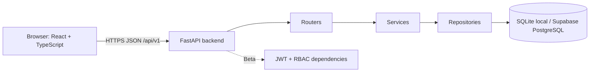
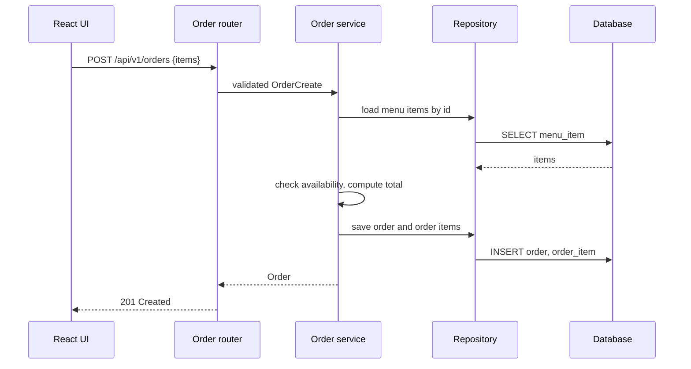
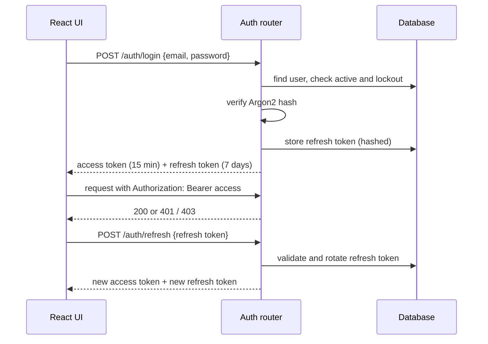
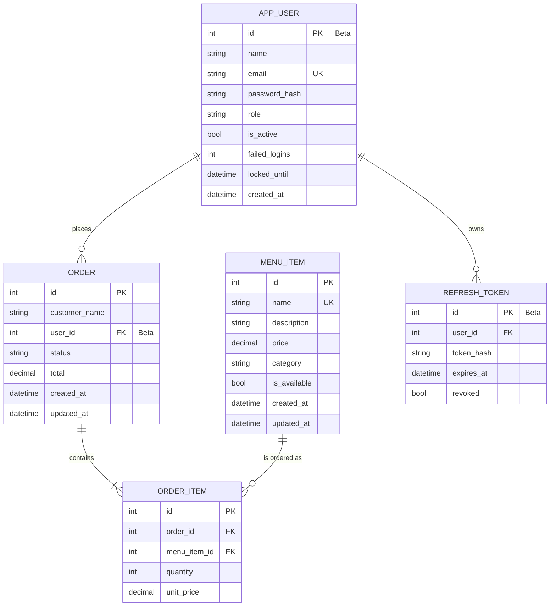

# Technical Design Document (TDD) - CampusEats

| | |
|---|---|
| **Project** | CampusEats - Campus Cafeteria Pre-Order System |
| **Document** | TDD (Technical Design Document) |
| **Related docs** | [PRD](01-prd.md), [SRS](02-srs.md) |

Every component is tagged **MVP** or **Beta**. Requirement IDs (FR, NFR) refer to the [SRS](02-srs.md).

---

## 1. Tech Stack

| Layer | Technology | Release |
|-------|------------|---------|
| Frontend | React + TypeScript, built with Vite | MVP |
| Backend | FastAPI (Python) | MVP |
| ORM / validation | SQLModel (SQLAlchemy + Pydantic) | MVP |
| Database (local) | SQLite | MVP |
| Database (production) | Supabase PostgreSQL | Beta |
| API documentation | FastAPI OpenAPI at `/api/docs` | MVP |
| Migrations | Alembic | Beta |
| Authentication | PyJWT (access + refresh tokens) | Beta |
| Password hashing | Argon2 (`argon2-cffi`) | Beta |
| Hosting | Vercel (frontend and serverless API) | Beta |
| Version control | Git and GitHub (issue, branch, PR workflow) | MVP |

The project is created from the course base template (React + TypeScript frontend, FastAPI backend, Vercel configuration).

## 2. Architecture

### 2.1 System overview



### 2.2 Layers

| Layer | Responsibility |
|-------|----------------|
| Router | Defines endpoints, reads requests, returns responses and status codes |
| Service | Business rules: total calculation, status transitions, ownership checks |
| Repository | All database queries; the only layer that touches the session |
| Model / Schema | SQLModel tables and Pydantic request/response schemas |
| Dependencies (Beta) | `get_current_user`, `require_role(...)` for authentication and RBAC |

### 2.3 Request flow (place order)



### 2.4 Login and refresh flow (Beta)



## 3. Project Structure

```text
CampusEats/
  docs/
    01-prd.md
    02-srs.md
    03-tdd.md
  frontend/
    src/
      components/        reusable UI parts
      pages/             MenuPage, OrderPage, KitchenBoard, Profile (Beta), Admin (Beta)
      services/          API client functions
      App.tsx
      main.tsx
    package.json
    vite.config.ts
  backend/
    app/
      main.py            FastAPI app, CORS, router registration
      core/              config (env vars), security (Beta)
      db/                engine, session, init
      models/            SQLModel tables
      schemas/           Pydantic request/response models
      repositories/      database access
      services/          business logic
      routers/           menu, orders, auth (Beta), users (Beta), admin (Beta)
      dependencies/      auth and RBAC (Beta)
    alembic/             migrations (Beta)
    requirements.txt
  vercel.json
  README.md
```

## 4. Data Model

### 4.1 ERD



### 4.2 Tables

| Table | Release | Notes |
|-------|---------|-------|
| `menu_item` | MVP | `category` is one of `meal`, `snack`, `drink`, `dessert`; name is unique |
| `order` | MVP | `status` is one of `pending`, `preparing`, `ready`, `completed`, `cancelled`; in the MVP `customer_name` identifies the customer |
| `order_item` | MVP | Stores `unit_price` at order time so later price changes do not alter old orders |
| `app_user` | Beta | `role` is `customer`, `kitchen_staff` or `admin`; default role on register is `customer` |
| `refresh_token` | Beta | Only a hash of the token is stored; tokens are rotated and can be revoked |

## 5. REST API Design

Base path: `/api/v1`. Interactive docs: `/api/docs`.

### 5.1 MVP endpoints (no authentication)

| Method | Endpoint | Description | Success | FR |
|--------|----------|-------------|---------|----|
| POST | `/menu` | Create menu item | 201 | FR-01 |
| GET | `/menu` | List items (`category`, `available`, `q` filters) | 200 | FR-02 |
| GET | `/menu/{id}` | Get one item | 200 | FR-03 |
| PATCH | `/menu/{id}` | Update item | 200 | FR-04 |
| DELETE | `/menu/{id}` | Delete item (409 if used) | 204 | FR-05 |
| POST | `/orders` | Place order | 201 | FR-06 |
| GET | `/orders` | List orders (`status` filter) | 200 | FR-07 |
| GET | `/orders/{id}` | Get order with items | 200 | FR-08 |
| PATCH | `/orders/{id}/status` | Change status (valid transitions only) | 200 | FR-09 |
| POST | `/orders/{id}/cancel` | Cancel a pending order | 200 | FR-10 |

### 5.2 Beta endpoints and who can call them

| Method | Endpoint | Description | Allowed roles | FR |
|--------|----------|-------------|---------------|----|
| POST | `/auth/register` | Register account | Public | FR-12 |
| POST | `/auth/login` | Login, get tokens | Public | FR-13 |
| POST | `/auth/refresh` | New access token | Public (valid refresh token) | FR-14 |
| POST | `/auth/logout` | Revoke refresh token | Any logged-in user | FR-14 |
| GET | `/users/me` | Own profile | Customer, Kitchen Staff, Admin | FR-15 |
| PATCH | `/users/me` | Update own name | Customer, Kitchen Staff, Admin | FR-16 |
| POST | `/users/me/password` | Change own password | Customer, Kitchen Staff, Admin | FR-16 |
| GET | `/menu`, `/menu/{id}` | Browse menu | Public | FR-02, FR-03 |
| POST, PATCH, DELETE | `/menu`, `/menu/{id}` | Manage menu | Admin | FR-01, FR-04, FR-05 |
| POST | `/orders` | Place order (linked to user) | Customer | FR-06, FR-17 |
| GET | `/orders/my` | Own orders | Customer | FR-18 |
| GET | `/orders` | All orders | Kitchen Staff, Admin | FR-07 |
| GET | `/orders/{id}` | Order detail (owner, staff or admin) | Customer (own), Kitchen Staff, Admin | FR-08, FR-18 |
| PATCH | `/orders/{id}/status` | Change status | Kitchen Staff, Admin | FR-09 |
| POST | `/orders/{id}/cancel` | Cancel pending order | Customer (own), Admin | FR-10 |
| GET | `/admin/users` | List users | Admin | FR-20 |
| PATCH | `/admin/users/{id}` | Change role or active state | Admin | FR-20, FR-21 |
| GET | `/admin/stats` | Dashboard statistics | Admin | FR-22 |

### 5.3 Error format

All errors use one JSON shape:

```json
{ "detail": "Human readable message", "code": "ORDER_INVALID_TRANSITION" }
```

## 6. Authentication, RBAC and Profile Design (Beta)

### 6.1 Tokens

| Item | Design |
|------|--------|
| Access token | JWT signed with `JWT_SECRET`, expires in 15 minutes, claims: `sub` (user id), `role`, `exp` |
| Refresh token | Random token, expires in 7 days, stored hashed in `refresh_token`, rotated on every refresh |
| Transport | `Authorization: Bearer <access token>` header |
| Logout | Marks the refresh token as revoked |

### 6.2 Password hashing and lockout

- Passwords are hashed with Argon2 and never stored or logged in plain text (NFR-07).
- After 5 consecutive failed logins the account is locked for 15 minutes (`locked_until`); the API returns `429` (FR-23).
- A successful login resets `failed_logins`.

### 6.3 RBAC

- `get_current_user` decodes the access token and loads the active user (`401` if invalid, `403` if deactivated).
- `require_role("admin")` and `require_role("kitchen_staff", "admin")` are FastAPI dependencies attached to routes, so permissions follow the SRS permission matrix in one place (FR-19).
- Ownership checks (customer sees only own orders) are done in the service layer.

### 6.4 Profile

- `GET /users/me` returns name, email and role (never the hash).
- `POST /users/me/password` requires the current password and applies the same password rules as registration.

## 7. Admin Dashboard Statistics Design (Beta)

`GET /admin/stats` returns:

| Field | Source |
|-------|--------|
| `total_users` | Count of `app_user` |
| `orders_by_status` | `GROUP BY status` on `order` |
| `top_items` | Sum of `quantity` per `menu_item_id` from `order_item`, top 5 |

## 8. Security Design

| Area | Design | Release |
|------|--------|---------|
| Input validation | Pydantic schemas on every request body and query | MVP |
| SQL injection | ORM with parameterised queries only | MVP |
| Authentication | JWT access + refresh tokens | Beta |
| Authorisation | RBAC dependencies on all protected routes | Beta |
| Passwords | Argon2 hashes, strength rules | Beta |
| Brute force | Login lockout after 5 failures | Beta |
| CORS | Only the configured `FRONTEND_ORIGIN` is allowed | Beta |
| Security headers | `X-Content-Type-Options`, `X-Frame-Options`, `Referrer-Policy` | Beta |
| Secrets | Environment variables only; `.env` is in `.gitignore` | Beta |

## 9. Configuration

| Variable | Used in | Example / note | Release |
|----------|---------|----------------|---------|
| `DATABASE_URL` | backend | `sqlite:///./campuseats.db` locally; Supabase connection string in production | MVP |
| `FRONTEND_ORIGIN` | backend | `http://localhost:5173` locally, deployed URL in production | Beta |
| `JWT_SECRET` | backend | Long random string, never committed | Beta |
| `ACCESS_TOKEN_MINUTES` | backend | `15` | Beta |
| `REFRESH_TOKEN_DAYS` | backend | `7` | Beta |
| `VITE_API_BASE_URL` | frontend | `/api/v1` | MVP |

An `.env.example` file lists variable names without real values. Real secrets are set in the local `.env` file and in the Vercel project settings.

## 10. Local Development (MVP)

1. Backend: create a virtual environment, `pip install -r requirements.txt`, run `uvicorn app.main:app --reload` from `backend/`.
2. Frontend: run `npm install` then `npm run dev` from `frontend/`.
3. Open the UI at `http://localhost:5173` and the API docs at `/api/docs`.
4. The SQLite file is created automatically on first run.

## 11. Database Setup and Migrations

| Step | Description | Release |
|------|-------------|---------|
| Local | Tables are created from SQLModel metadata on startup | MVP |
| Supabase | Create a Supabase project and copy the PostgreSQL connection string into `DATABASE_URL` | Beta |
| Migrations | Alembic revisions for `app_user`, `refresh_token` and the `order.user_id` column | Beta |
| Seed data | Script to create sample menu items and one admin user | Beta |

## 12. Deployment (Beta)

| Item | Design |
|------|--------|
| Frontend | Built by Vite and served by Vercel |
| Backend | FastAPI served as a Vercel serverless function; `vercel.json` routes `/api/*` to the backend |
| Database | Supabase PostgreSQL, accessed through `DATABASE_URL` |
| Branch flow | Work is done on feature branches and merged to `main` through a PR; Vercel creates a preview deployment per PR and a production deployment from `main` |
| Release tags | `v0.1.0` for MVP and `v0.2.0` for Beta |

Deployment checklist:

- [ ] Environment variables set in Vercel
- [ ] Supabase connection works from the deployed API
- [ ] CORS origin matches the deployed frontend URL
- [ ] `/api/docs` reachable
- [ ] Admin account seeded, demo data loaded

## 13. Risks

| Risk | Impact | Mitigation |
|------|--------|------------|
| Serverless cold starts slow the first request | NFR-01 may be missed at first call | Keep the API small, warm it before the demo |
| Supabase connection limits | Errors under load | Use the pooled connection string |
| JWT secret leaked | Account takeover | Env vars only, rotate if exposed |
| Scope creep | Unfinished Beta | Keep features limited to the PRD list |
