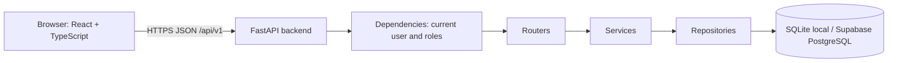
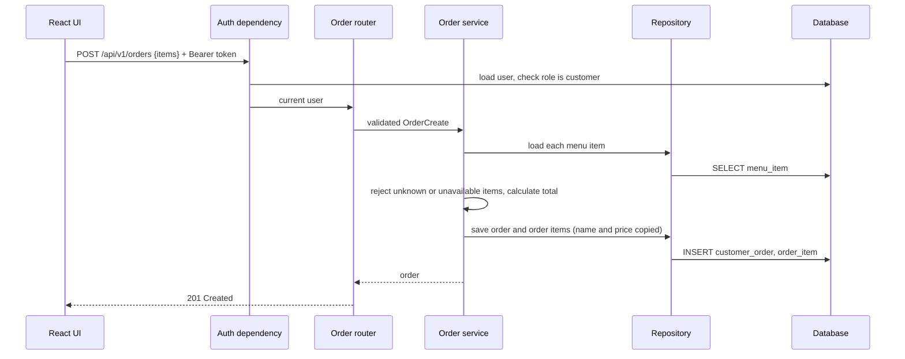
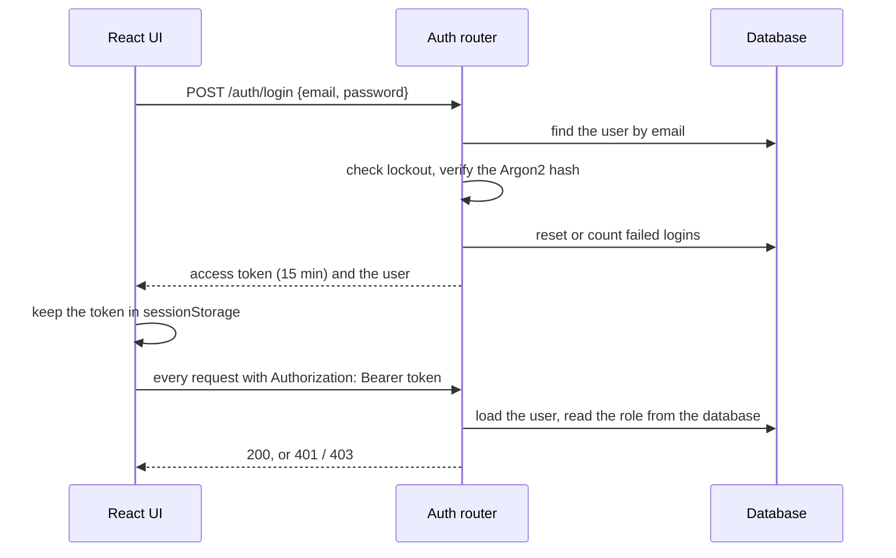
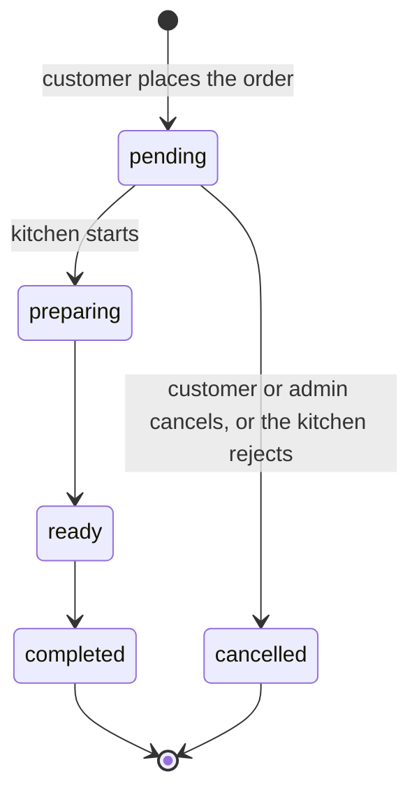
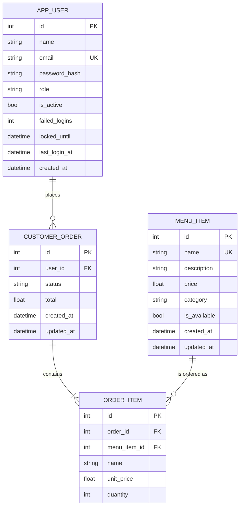

# Technical Design Document (TDD) - CampusEats

| | |
|---|---|
| **Project** | CampusEats - Campus Cafeteria Pre-Order System |
| **Document** | TDD (Technical Design Document) |
| **Related docs** | [PRD](01-prd.md), [SRS](02-srs.md) |

This version describes the system as it is built for the final demo. Items marked **Planned** are not built yet. Requirement IDs (FR, NFR) refer to the [SRS](02-srs.md).

---

## 1. Tech Stack

| Layer | Technology | Status |
|-------|------------|--------|
| Frontend | React + TypeScript, built with Vite, React Router | Done |
| Backend | FastAPI (Python) | Done |
| ORM and validation | SQLModel (SQLAlchemy + Pydantic) | Done |
| Database (local) | SQLite | Done |
| Database (production) | Supabase PostgreSQL through the transaction pooler (`psycopg`) | Done |
| API documentation | FastAPI OpenAPI at `/api/docs` | Done |
| Password hashing | Argon2id (`argon2-cffi`) with a salt | Done |
| Access token | JWT (`PyJWT`, HS256), 15 minutes | Done |
| Refresh token | Random token stored hashed, 7 days | Planned |
| Migrations | Alembic | Planned (tables are created at start-up, see section 11) |
| Hosting | Vercel (FastAPI backend service and Vite frontend service) | Done |
| Version control | Git and GitHub (issue, branch and pull request workflow) | Done |

The project was created from the course base template (React + TypeScript frontend, FastAPI backend, Vercel configuration).

## 2. Architecture

### 2.1 System overview



### 2.2 Layers

| Layer | Responsibility |
|-------|----------------|
| Dependencies | `get_current_user` reads the token and loads the user; `require_roles(...)` allows only the listed roles (401 or 403) |
| Router | Defines endpoints, reads requests, returns responses and status codes |
| Service | Business rules: totals, status steps, ownership checks, lockout, duplicate email |
| Repository | All database queries; the only layer that touches the session |
| Model and schema | SQLModel tables and Pydantic request and response shapes |

### 2.3 Request flow: placing an order



### 2.4 Login flow



### 2.5 Order status steps



## 3. Project Structure

```text
CampusEats/
  docs/                       PRD, SRS, TDD
  vercel.json                 services: backend (FastAPI) and frontend (Vite)
  backend/
    main.py                   FastAPI app, routers, error handler, /api/health
    scripts/set_role.py       change the role of an account
    app/
      config.py               settings from environment variables
      clock.py                UTC time helpers
      security.py             Argon2 hashing and JWT helpers
      database.py             engine, session, table creation
      menu_items/             model, schemas, repository, service, router
      users/                  model, schemas, repository, service
      auth/                   dependencies (current user, roles) and router
      orders/                 model, schemas, repository, service, router
  frontend/
    vercel.json               rewrites every path to index.html
    src/
      components/             MenuItemForm, CartPanel, ProtectedRoute
      context/                AuthContext, CartContext
      pages/                  Menu, details, add and edit item, Login, Register,
                              Profile, MyOrders, Kitchen
      services/api.ts         the only place that calls the backend
      types/                  menuItem.ts, auth.ts, order.ts
      App.tsx, App.css
```

## 4. Data Model

### 4.1 ERD



### 4.2 Tables

| Table | Notes |
|-------|-------|
| `menu_item` | `category` is one of meal, snack, drink, dessert; the name is unique |
| `app_user` | `role` is customer, kitchen_staff or admin (default customer); `password_hash` is an Argon2id hash; `failed_logins` and `locked_until` implement the lockout |
| `customer_order` | `status` is pending, preparing, ready, completed or cancelled; the table is not called `order` because that is a reserved word in SQL |
| `order_item` | The item name and unit price are copied when the order is placed, so later menu changes do not change old orders; `menu_item_id` keeps a link so a used item cannot be deleted |

A `refresh_token` table (hashed token, owner, expiry, revoked flag) is planned for the refresh flow.

## 5. REST API Design

Base path: `/api/v1`. Interactive docs: `/api/docs`. Requests and responses use `application/json`.

### 5.1 Menu

| Method | Endpoint | Who | Result | FR |
|--------|----------|-----|--------|----|
| GET | `/menu?offset=0&limit=20` | Public | 200, `{items, total, offset, limit}` (limit 1 to 100); optional `category`, `available`, `q` filters | FR-02 |
| GET | `/menu/{id}` | Public | 200 or 404 | FR-03 |
| POST | `/menu` | Admin | 201 | FR-01, FR-27 |
| PATCH | `/menu/{id}` | Admin | 200 or 404; only sent fields change | FR-04, FR-27 |
| DELETE | `/menu/{id}` | Admin | 204, 404, or 409 if the item is part of an order | FR-05, FR-27 |

### 5.2 Accounts

| Method | Endpoint | Who | Result | FR |
|--------|----------|-----|--------|----|
| POST | `/auth/register` | Public | 201; the role is always customer; 409 for a duplicate email; 422 for a weak password | FR-12 |
| POST | `/auth/login` | Public | 200 with an access token; the same 401 message for a wrong email or password; 403 for a deactivated account; 429 while locked | FR-13, FR-23 |
| GET | `/auth/me` | Any logged-in user | 200, or 401 | FR-15 |
| POST | `/auth/refresh`, `/auth/logout` | Logged in | Planned | FR-14 |
| PATCH | `/users/me`, `POST /users/me/password` | Logged in | Planned | FR-16 |
| GET, PATCH | `/admin/users`, `/admin/users/{id}` | Admin | Planned | FR-20, FR-21 |
| GET | `/admin/stats` | Admin | Planned | FR-22 |

### 5.3 Orders

| Method | Endpoint | Who | Result | FR |
|--------|----------|-----|--------|----|
| POST | `/orders` | Customer | 201; 422 for unknown or unavailable items or a bad quantity (1 to 20, each item once) | FR-06 |
| GET | `/orders/my?offset=0&limit=20` | Customer | 200, paged | FR-18 |
| GET | `/orders?status=pending&offset=0&limit=20` | Kitchen staff, admin | 200, paged, filter by status | FR-07 |
| GET | `/orders/{id}` | Owner, kitchen staff, admin | 200; 404 for another customer's order | FR-08, FR-26 |
| PATCH | `/orders/{id}/status` | Kitchen staff, admin | 200; 409 for a step that is not allowed | FR-09 |
| POST | `/orders/{id}/cancel` | Customer (own), admin | 200; 409 unless the order is pending | FR-10 |

### 5.4 Error format

Errors use FastAPI's JSON shape: `{"detail": "Human readable message"}`. Validation errors return 422 with a list of problems. An unexpected error returns 500 with `{"detail": "Internal server error"}`, and the real error is only written to the server log.

## 6. Authentication and Authorization Design

| Topic | Design |
|-------|--------|
| Passwords | Hashed with Argon2id and a salt. The plain password is never stored or logged. Rules: 8 to 128 characters with a letter and a digit |
| Registration | Always creates a customer. A role sent by the client is ignored. Admins and kitchen staff are made with `scripts/set_role.py` or by changing the role in the database |
| Access token | JWT signed with `JWT_SECRET` (HS256), claims `sub`, `role`, `iat`, `exp`; lifetime 15 minutes |
| Token on the client | Kept in `sessionStorage` and sent as `Authorization: Bearer`; closing the tab ends the login. A script on the page could read it, which is why it is short-lived. The planned refresh token will use an HttpOnly cookie |
| Lockout | 5 failed logins lock the account for 15 minutes (429). A successful login resets the counter |
| Login errors | One message, "Invalid email or password", for a wrong email and a wrong password. A dummy hash is checked when the email is unknown, so the response time does not reveal which emails exist |
| Current user | `get_current_user` verifies the signature and expiry, loads the user from the database, and rejects missing, expired or deactivated users with 401 |
| Roles | `require_roles(...)` compares the role **read from the database** with the allowed list, so a role change applies at once. 403 for a wrong role |
| Ownership | Customers see only their own orders; another customer's order returns 404 |
| Frontend | `ProtectedRoute` redirects logged-out users to the login page and blocks pages by role. The buttons for each role are only a convenience; the server is the real protection |

## 7. Frontend Design

| Route | Page | Who |
|-------|------|-----|
| `/` | Menu list with pagination, filter and search; cart for customers; admin buttons for admins | Public |
| `/menu/:id` | Menu item details | Public |
| `/menu/new`, `/menu/:id/edit` | Add and edit a menu item | Admin |
| `/login`, `/register` | Log in and sign up | Public |
| `/profile` | My account | Logged in |
| `/orders` | My orders with statuses, cancelling and a refresh every 15 seconds | Customer |
| `/kitchen` | Kitchen board with status tabs, paging, next-step buttons and a refresh every 10 seconds | Kitchen staff, admin |

State: `AuthContext` holds the current user and restores a saved session at start-up; `CartContext` holds the cart in memory. All backend calls are in `services/api.ts`, which adds the token and logs the user out when the server answers 401.

## 8. Security Design

| Area | Design | Status |
|------|--------|--------|
| Input validation | Pydantic schemas on every body and query | Done |
| SQL injection | ORM with parameterised queries only | Done |
| Authentication | Argon2 hashes, JWT access token | Done |
| Authorization | Role dependencies on protected routes, ownership checks in services | Done |
| Brute force | Lockout after 5 failures, one generic login message | Done |
| Secrets | Environment variables only; the app refuses to start on Vercel without `JWT_SECRET`; `.env` is not committed | Done |
| Prices | The server calculates totals from the menu; the client never sends a price | Done |
| Refresh token and logout on the server | HttpOnly cookie, hashed token, rotation | Planned |
| Security headers | `X-Content-Type-Options`, `X-Frame-Options`, `Referrer-Policy` | Planned |
| CORS | Not needed: the frontend and the API share one domain | Done |

## 9. Configuration

| Variable | Used in | Note |
|----------|---------|------|
| `DATABASE_URL` | backend | Unset locally (SQLite file `backend/campuseats.db`). In production the Supabase transaction pooler URL (port 6543); special characters in the password must be URL-encoded |
| `POSTGRES_URL` | backend | Used when `DATABASE_URL` is not set |
| `JWT_SECRET` | backend | A long random string. Required on Vercel (the app refuses to start without it); a fixed development value is used locally |
| `ACCESS_TOKEN_MINUTES` | backend | Default 15 |
| `REFRESH_TOKEN_DAYS` | backend | Default 7, used by the planned refresh flow |

Secrets are set in the Vercel project settings and in a local `.env` that is never committed.

## 10. Local Development

1. Backend: create a virtual environment, `pip install -r requirements.txt`, then `fastapi dev main.py` in `backend/`.
2. Frontend: `npm install`, then `npm run dev` in `frontend/`.
3. Open `http://localhost:5173` for the app and `http://localhost:8000/api/docs` for the API.
4. Make an admin or kitchen account: register it in the app, then `python scripts/set_role.py <email> <admin|kitchen_staff>` in `backend/`.

## 11. Database Setup

| Item | Design |
|------|--------|
| Tables | Created at start-up from the SQLModel models (`init_db`). This adds missing tables only and never changes an existing table, so a new column in an old table needs a migration |
| Migrations | Alembic is planned for column changes |
| Supabase | Use the transaction pooler string. The engine uses `NullPool` and `prepare_threshold=None`, as the pooler requires |
| Access | The backend connects as the database user. Row Level Security is not used because the app never calls Supabase's public API |

## 12. Deployment

| Item | Design |
|------|--------|
| Services | The root `vercel.json` defines a backend service (`backend`, FastAPI, `main:app`) and a frontend service (`frontend`, Vite); `/api/*` goes to the backend and everything else to the frontend |
| Page reload | `frontend/vercel.json` rewrites every path to `index.html`, so a reload of `/menu/3` works |
| Branch flow | Work is done on feature branches and merged to `main` through a pull request; Vercel builds a preview for each pull request and deploys `main` to production |
| First admin | Register the account on the live site, then change its role in the Supabase Table Editor |

Deployment checklist:

- [x] `DATABASE_URL` and `JWT_SECRET` set in Vercel for Production and Preview
- [x] Supabase reachable from the deployed API
- [x] `/api/docs` reachable
- [x] Admin, kitchen and customer accounts created for the demo
- [x] Page reload works on `/menu/<id>`

## 13. Risks

| Risk | Impact | Mitigation |
|------|--------|------------|
| Serverless cold starts | A slow first request | Open the site before a demo |
| Supabase free project pauses after inactivity | Requests fail with 500 | Check that the project is healthy before a demo |
| `JWT_SECRET` leaked | Anyone could forge tokens | Keep it in environment variables only; change it if it is exposed |
| Password for the database contains special characters | The connection string breaks | Use letters and numbers, or URL-encode the password |
| Token kept in `sessionStorage` | Readable by a script on the page | Short lifetime; planned HttpOnly refresh cookie |
| Accounts are not verified by email | Anyone can register with any email | Known limit; a new account is only a customer |